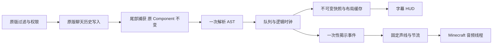

# 架构

`minecraft-api` 定义纯 Java DTO 和字体、时钟、音频后端契约。`engine` 只依赖这一契约层，包含有界 CCML 扫描器、AST、Unicode 分段、时间线、不可变运行快照、队列和像素布局。Gradle `verifyIsolation` 检查核心没有 Minecraft、Loader、Mixin、文件、网络、反射及脚本执行依赖。

`client-common` 管理配置工作副本、异步原子保存、HUD 编辑模型、视觉预设、说话者匹配、shuffle bag、揭示事件节流、受限音频路径与异步解码缓存。版本 adapter 负责 Component 转换、实际字体和 HUD、原生 Screen、OGG 解码及 Minecraft 声道桥接。Loader 层注册事件、客户端命令、按键和 metadata。

## 消息流程

Loader 聊天事件仅提供结构化上下文，不入字幕队列。1.21.x 最终三参数 `ChatComponent.addMessage` 的 TAIL 是唯一入队点；26.1.x 改为准入过滤之后的 `addMessageToQueue(GuiMessage)` TAIL，避免重新显示被权限过滤器拒绝的消息。相同文本的两次真实消息保留两个不同 ID。撤回通过签名引用移除字幕；原版历史、举报和 narrator 逻辑保留。

ChatScreen 和编辑预览会话暂停实际字幕并静音。F1 隐藏并静音；世界离开时清空字幕与音频。预览使用自己的队列与配置工作副本。保存后应用；Cancel/Esc 丢弃副本。

全文像素布局保持稳定；长字幕通过有界视口显示，并跟随最新显现的行。renderer 二分查找已显现及视口内的 glyph 范围，避免为屏幕外全文提交绘制。视口不推进引擎或发送声音事件。

## 音频生命周期

文件读取和 WAV/OGG 解码在后台执行，未就绪的声音直接跳过，字幕正常推进。失败缓存至 reload，代次标识丢弃迟到结果。Native SoundBuffer 和 Channel 由 Minecraft SoundEngineExecutor 管理。reload 先停止本模组声道，再让 Minecraft 清理停止的声道，最后删除缓冲；设备关闭前同步完成该清理。

主配置、声线、HUD 预设各自版本化。损坏 JSON 备份为 `.corrupt-时间戳` 并恢复默认。启动先使用默认值，后台读取文件后回到客户端线程应用。保存与重载在同一个 IO executor 按顺序执行；代次标识拒绝覆盖较新的编辑结果。配置序列化先生成快照，后台临时文件写入后原子替换。

客户端命令消费后延迟打开界面，避免 ChatScreen 的发送后关闭动作覆盖新界面。1.21/1.21.1 使用 `tell`，1.21.2 起使用 `schedule`；差异集中在目标 `ClientTasks`，共享业务不判断版本。
